<p align="center">
  
</p>

<h1 align="center">ÁGORA TECH</h1>
<h2 align="center">Hackea la Participación: Datos que Construyen Democracia (INE 2026)</h2>
<h3 align="center">Reto 2: Predicción y Escenarios de Riesgo de Abstención Electoral</h3>

<p align="center">
  <b>Plataforma integral de analítica predictiva territorial, semaforización de alerta temprana y simulador contrafactual de política pública preventiva (ENCCÍVICA) sobre 54.8 millones de registros electorales censales (2009–2024).</b>
</p>

<p align="center">
  
  
  
  
  
  
  
  
</p>

---

## Tabla de Contenidos
1. [Resumen Ejecutivo e Impacto Institucional](#1-resumen-ejecutivo-e-impacto-institucional)
2. [Suite de Documentación Técnica (Carpeta `docs/`)](#2-suite-de-documentación-técnica-carpeta-docs)
3. [Diagrama de Flujo Paso a Paso (Pipeline End-to-End)](#3-diagrama-de-flujo-paso-a-paso-pipeline-end-to-end)
4. [Arquitectura del Proyecto y Estructura Limpia](#4-arquitectura-del-proyecto-y-estructura-limpia)
5. [Metodología de Modelado: ¿Por qué Machine Learning y no Deep Learning?](#5-metodología-de-modelado-por-qué-machine-learning-y-no-deep-learning)
6. [Semáforo de Riesgo Territorial y Arquetipos Diagnósticos](#6-semáforo-de-riesgo-territorial-y-arquetipos-diagnósticos)
7. [Simulador de Escenarios Contrafactuales (Horizonte 2027)](#7-simulador-de-escenarios-contrafactuales-horizonte-2027)
8. [Privacidad por Diseño y Protección de Datos Personales (Base Cuarta)](#8-privacidad-por-diseño-y-protección-de-datos-personales-base-cuarta)
9. [Guía de Ejecución Local Detallada con `uv`](#9-guía-de-ejecución-local-detallada-con-uv)
10. [Catálogo de Entregables Oficiales (Base Sexta)](#10-catálogo-de-entregables-oficiales-base-sexta)
11. [Equipo y Créditos](#11-equipo-y-créditos)

---

## 2. Suite de Documentación Técnica (Carpeta `docs/`)

Para una revisión exhaustiva de cada uno de los aspectos científicos, matemáticos, jurídicos y de ingeniería del proyecto, consulta los seis documentos técnicos especializados disponibles en la carpeta [`docs/`](docs/):

| Documento Técnico | Temáticas Abordadas en Profundidad |
| :--- | :--- |
| 📘 [**01. Guía de Ejecución Local Detallada**](docs/01_guia_ejecucion_local_detallada.md) | Requisitos de hardware/SO, sincronización `uv sync`, manual de comandos CLI `ine-riesgo`, visualización de mapas y troubleshooting. |
| 📙 [**02. Auditoría de Calidad y Saneamiento**](docs/02_auditoria_datos_y_saneamiento.md) | Desglose de los 194 archivos (54.8M de filas), aislamiento modal 2024, llaves canónicas `ID_MUN_INE` y auditoría $LN = SV + NV + NS$. |
| 📗 [**03. Metodología de Modelado y Métricas**](docs/03_metodologia_modelado_y_metricas.md) | Justificación de ML vs. Deep Learning, backtesting ciego 2021/2024, glosario de métricas (MAE, WMAE, RMSE, $R^2$, Prec@20) y coeficientes. |
| 📕 [**04. Semáforo Territorial y Arquetipos**](docs/04_semaforo_territorial_y_arquetipos.md) | Formulación del Índice Z Robusto (0–100), calibración de los 4 niveles del Semáforo y los 5 Arquetipos Diagnósticos con fórmulas. |
| 📓 [**05. Simulador de Escenarios y Política Pública**](docs/05_simulador_escenarios_y_politica.md) | Simulación contrafactual 2027/2030, supuestos ENCCÍVICA, tabla de votos recuperados por estado y curva de concentración de Pareto (Top 15%). |
| 🔒 [**06. Privacidad, Anonimización y Ética Pública**](docs/06_privacidad_anonimizacion_y_etica.md) | Cumplimiento formal de la Base Cuarta, disociación total, ausencia absoluta de PII, garantía de $k$-anonimato $\ge 100$ y pruebas automatizadas. |

---

---

## 1. Resumen Ejecutivo e Impacto Institucional

El **Reto 2** del concurso nacional convocado por el Instituto Nacional Electoral (INE) exige modelar los factores asociados a la abstención ciudadana, construir un sistema de alerta territorial y diseñar escenarios de intervención institucional sin vulnerar la privacidad de las personas.

**Ágora Tech** desarrolló una solución tecnológica y científica completa que ingesta los **192 archivos censales territoriales** de los Conteos Censales de Participación Ciudadana (**54,872,712 registros individuales** en 6 elecciones federales consecutivas: 2009, 2012, 2015, 2018, 2021 y 2024), aislando metodológicamente las 2 modalidades especiales de 2024 (*Prisión Preventiva* y *Voto Anticipado*).

### Hallazgos y Resultados Centrales
* **Proyección Inercial Sin Intervención (2027):** Se proyecta una abstención nacional del **44.49%** (55.51% de participación; 45.88 millones de no votantes), con **298 municipios en Riesgo Crítico** y **445 en Riesgo Alto**.
* **Eficacia del Portafolio Óptimo INE (Escenario Central Con Intervención):** Mediante una asignación presupuestal estratégica focalizada en el **15% de municipios de mayor retorno cívico** y zonas críticas, la abstención nacional se reduce al **41.68%** (**+2,900,891 votos recuperados**) y **208 municipios salen de Riesgo Crítico** (reduciéndolos de 298 a solo 90).
* **Regla de Concentración (Pareto Electoral):** El análisis de curvas de retorno demuestra que intervenir en apenas el **15% del territorio nacional captura el 90.7% del beneficio cívico potencial**, optimizando al máximo los recursos de la Estrategia Nacional de Cultura Cívica (**ENCCÍVICA**).

---

## 3. Diagrama de Flujo Paso a Paso (Pipeline End-to-End)

El siguiente diagrama detalla la arquitectura modular y el flujo secuencial de los datos, desde los insumos crudos hasta los entregables de alta dirección:

```mermaid
flowchart TD
    classDef raw fill:#E9ECEF,stroke:#6C757D,stroke-width:1.5px,color:#212529;
    classDef bronze fill:#FFE8D6,stroke:#DDA15E,stroke-width:1.5px,color:#212529;
    classDef silver fill:#D8E2DC,stroke:#84A98C,stroke-width:1.5px,color:#212529;
    classDef gold fill:#FFE5D9,stroke:#D4A373,stroke-width:1.5px,color:#212529;
    classDef model fill:#E0E1DD,stroke:#415A77,stroke-width:1.5px,color:#212529;
    classDef output fill:#5B1F56,stroke:#2B0938,stroke-width:2px,color:#FFFFFF;

    subgraph INSUMOS["0. Insumos Crudos (CCPC INE 2009–2024)"]
        CSV_RAW["192 Archivos CSV Territoriales<br/>(32 Entidades × 6 Elecciones Federales)<br/>+ 2 Modales Especiales 2024 (3.56 GB)"]:::raw
    end

    subgraph FASE1["1. Ingesta Vectorial y Saneamiento (Bronze a Silver)"]
        INGEST["ine-riesgo ingest<br/>Motor Streaming Polars / PyArrow"]:::bronze
        AUDIT["Auditoría Contable:<br/>LN = SV + NV + NS (54.8M filas)"]:::bronze
        MODAL_SPLIT["Aislamiento de Archivos Modales 2024<br/>(Prisión Preventiva y Voto Anticipado)"]:::bronze
        SILVER_PQ["data/silver/ccpc_2009_2024.parquet<br/>Llaves Canónicas Invariantes:<br/>ID_MUN_INE & ID_SEC_INE"]:::silver
    end

    subgraph FASE2["2. Ingeniería de Características (Silver a Gold)"]
        PANEL_BUILD["ine-riesgo features<br/>Panel Builder Longitudinal"]:::silver
        VARS["Variables Sociodemográficas:<br/>• Brecha de Abstención Juvenil (18-29)<br/>• Proporción 60+ y Primer Voto (18-19)<br/>• Morfología Urbana / Rural / Mixta<br/>• Rezagos Homólogos Intermedios (t-6)"]:::silver
        CORR["Diagnóstico Estadístico:<br/>• Correlación Pearson / Spearman<br/>• Matriz Multicolinealidad VIF &lt; 5.0"]:::gold
        GOLD_PANEL["data/gold/panel_municipal_2009_2024.parquet<br/>(14,779 obs. × 2,477 municipios)<br/>+ panel_seccional_2015_2024.parquet"]:::gold
    end

    subgraph FASE3["3. Modelado Predictivo y Validación Ciega (Backtesting)"]
        TRAIN["ine-riesgo train<br/>Model Trainer & Evaluator"]:::gold
        M_BASE["1. Baseline Homólogo (t-6)<br/>Inercia histórica"]:::model
        M_LOGIT["2. Regresión Logit Regularizada Ridge<br/>Probabilidades acotadas (0,1) + Efectos marginales"]:::model
        M_GBDT["3. HistGradientBoosting (GBDT)<br/>No-linealidades e interacciones espaciales"]:::model
        M_ENS["4. Ensamble Híbrido Ponderado INE<br/>70% Logit Regularizado + 30% GBDT"]:::model
        BACKTEST["Backtesting Temporal Ciego Fuera de Muestra:<br/>• Intermedia 2021 (Entrena &le;2018)<br/>• Presidencial 2024 (Entrena &le;2021)<br/>R² = 0.458 | Spearman ρ = 0.803 | Prec@20 = 66.5%"]:::model
    end

    subgraph FASE4["4. Semáforo Territorial y Simulación Contrafactual"]
        SIM["ine-riesgo simulate<br/>Simulador de Escenarios 2027"]:::gold
        SEMAFORO["Índice Compuesto de Riesgo (0–100):<br/>• Nivel Esperado (55%)<br/>• Deterioro Histórico (25%)<br/>• Masa Crítica Abstencionistas (20%)<br/>Semáforo: Bajo, Moderado, Alto, Crítico"]:::gold
        ARQUETIPOS["Arquetipos Diagnósticos:<br/>• Desconexión Juvenil Urbana<br/>• Fatiga Electoral Intermedia<br/>• Barrera Geográfica Rural<br/>• Resiliencia Cívica Participativa"]:::gold
        SCENARIOS["Simulación Contrafactual (2027):<br/>• Esc. 0: Línea Base Sin Intervención (44.49%)<br/>• Esc. 1: Juventudes 18-29 (+1.18M votos)<br/>• Esc. 2: Brigadas Rurales (+798K votos)<br/>• Esc. 3B: Portafolio Óptimo INE (+2.90M votos)"]:::gold
    end

    subgraph FASE5["5. Generación de Entregables Oficiales (Base Sexta)"]
        DELIV["ine-riesgo deliverables<br/>Generador Automático de Entregables"]:::output
        PDF_REP["Reporte Metodológico Oficial<br/>(12 cuartillas en PDF profesional)"]:::output
        PDF_SLI["Presentación Ejecutiva para Jurado<br/>(10 láminas en PDF horizontal)"]:::output
        MAP_HTML["Tablero Interactivo DualMap<br/>(HTML interactivo con polígonos reales)"]:::output
        SIG_FILES["Cartografía SIG Nacional:<br/>• .GPKG Multicapa (Entidades y Mun.)<br/>• GeoJSON Estados y Municipios"]:::output
        ANON_BD["Bases de Datos Anonimizadas:<br/>• Libro Excel (.XLSX) con Diccionario<br/>• CSV Municipios y Top 1,000 Secciones"]:::output
    end

    CSV_RAW --> INGEST
    INGEST --> AUDIT --> MODAL_SPLIT --> SILVER_PQ
    SILVER_PQ --> PANEL_BUILD
    PANEL_BUILD --> VARS --> CORR --> GOLD_PANEL
    GOLD_PANEL --> TRAIN
    TRAIN --> M_BASE & M_LOGIT & M_GBDT --> M_ENS
    M_ENS --> BACKTEST
    BACKTEST --> SIM
    SIM --> SEMAFORO --> ARQUETIPOS --> SCENARIOS
    SCENARIOS --> DELIV
    DELIV --> PDF_REP & PDF_SLI & MAP_HTML & SIG_FILES & ANON_BD
```



---

## 4. Arquitectura del Proyecto y Estructura Limpia

El repositorio sigue estrictamente los principios de desarrollo modular, tipado estático, reproducibilidad determinista (`uv.lock`) y separación en capas (*Bronze / Silver / Gold*):

```text
hackaton-ine-reto2/
├── logo.jpeg                           # Identidad institucional del equipo Ágora Tech
├── pyproject.toml                      # Metadatos del paquete, dependencias y CLI ine-riesgo
├── uv.lock                             # Bloqueo determinista de versiones con hashes criptográficos
├── configs/
│   └── config.toml                     # Parámetros electorales, pesos del semáforo y elasticidades
├── docs/                               # Suite de documentación técnica especializada (6 whitepapers)
│   ├── 01_guia_ejecucion_local_detallada.md
│   ├── 02_auditoria_datos_y_saneamiento.md
│   ├── 03_metodologia_modelado_y_metricas.md
│   ├── 04_semaforo_territorial_y_arquetipos.md
│   ├── 05_simulador_escenarios_y_politica.md
│   └── 06_privacidad_anonimizacion_y_etica.md
├── src/
│   └── ine_abstencion/
│       ├── __init__.py                 # Exportación de versión y metadatos del paquete
│       ├── config.py                   # Modelos de configuración tipada (Pydantic / dataclasses)
│       ├── cli.py                      # Punto de entrada de línea de comandos (Click / Rich)
│       ├── ingestion/
│       │   ├── schema.py               # Contratos de datos, tipos y nombres de columnas canónicas
│       │   ├── catalogs.py             # Catálogos oficiales de 32 Entidades, Códigos y Circunscripciones
│       │   └── loader.py               # Ingesta streaming, saneamiento y desacople modal 2024
│       ├── features/
│       │   ├── panel_builder.py        # Agregación longitudinal a nivel Municipio y Sección
│       │   └── correlations.py         # Matrices de correlación Pearson/Spearman y factor VIF
│       ├── modeling/
│       │   ├── predictor.py            # Logit Regularizado, HistGBDT, Ensamble y Backtesting
│       │   └── risk_index.py           # Índice compuesto de riesgo (0-100) y Semáforo Territorial
│       ├── scenarios/
│       │   └── simulator.py            # Simulador contrafactual (Línea Base vs Portafolio INE 2027)
│       └── reporting/
│           ├── plots.py                # Generación de 8 figuras editoriales a 300 DPI (Matplotlib/Seaborn)
│           ├── geospatial.py           # Cartografía vectorial (.GPKG, .GeoJSON) y Tablero Web DualMap
│           └── deliverables.py         # Compilación de PDFs (ReportLab), Tablas y Excel anonimizado
├── tests/
│   └── test_pipeline.py                # Pruebas automatizadas (descubrimiento, catálogos y privacidad)
└── outputs/
    ├── figures/                        # 8 gráficos editoriales en alta resolución (300 DPI)
    ├── tables/                         # Tablas maestras de correlación, backtesting y coeficientes
    ├── geospatial/                     # Polígonos base oficiales de México (GeoJSON)
    └── entrega_final/                  # Paquete formal de entrega para el Jurado Calificador
        ├── Reporte_Metodologico_y_Preventivo_Reto2_INE.pdf
        ├── Presentacion_Ejecutiva_10_Diapositivas_Reto2_INE.pdf
        ├── Tablero_Interactivo_Escenarios_Sin_vs_Con_Intervencion_2027.html
        ├── Mapa_Escenarios_Riesgo_Abstencion_2027.gpkg
        ├── Mapa_Escenarios_Entidades_2027.geojson
        ├── Mapa_Escenarios_Municipios_2027.geojson
        ├── Base_Datos_Anonimizada_Reto2_INE_2027.xlsx
        ├── Base_Datos_Anonimizada_Escenarios_Municipios_2027.csv
        └── Base_Datos_Anonimizada_Top1000_Secciones_Criticas_2027.csv
```

---

## 5. Metodología de Modelado: ¿Por qué Machine Learning y no Deep Learning?

Una decisión central de diseño metodológico consistió en descartar redes neuronales profundas (*Deep Learning*) en favor de **Machine Learning Estadístico y Modelos de Ensamble Tabular**.

> Para el desglose matemático detallado y fórmulas de cada métrica, consulta [`docs/03_metodologia_modelado_y_metricas.md`](docs/03_metodologia_modelado_y_metricas.md).

### Razones Técnicas y Jurídicas
1. **Dimensión de la serie temporal electoral ($T = 6$):** Las elecciones federales ocurren cada 3 años. Las redes neuronales profundas sufren de **grave sobreajuste (*overfitting*)** al operar sobre paneles con pocos pasos temporales, memorizando coyunturas irrepetibles en lugar de aprender regularidades estructurales.
2. **Interpretabilidad para el INE y la ENCCÍVICA:** Una red neuronal es una «caja negra» que no permite explicar *por qué* se focaliza un recurso público. El INE requiere **fundamentación legal y presupuestal transparente**.
3. **Consistencia Probabilística:** El modelo Logit modela $\text{logit}(y) = \ln\left(\frac{y}{1-y}\right)$, asegurando que la abstención estimada pertenezca estrictamente al intervalo $(0\%, 100\%)$ y ponderando las observaciones por la Lista Nominal.

### Validación Temporal Ciega Fuera de Muestra (Backtesting)
Evaluamos los modelos entrenando exclusivamente con datos pasados para predecir a ciegas elecciones posteriores:

| Elección Evaluada | Modelo | MAE Ponderado por LN | RMSE (pp) | $R^2$ Ponderado | Spearman $\rho$ | Precisión en Top 20% Crítico |
| :--- | :--- | :---: | :---: | :---: | :---: | :---: |
| **Presidencial 2024**<br/>*(Entrena $\le 2021$)* | 1. Baseline Homólogo ($t-6$) | 4.38 pp | 9.08 pp | 0.360 | 0.758 | 64.31% |
| | 2. Logit Regularizado (Ridge) | **4.11 pp** | 9.24 pp | 0.444 | 0.781 | 64.92% |
| | 3. HistGradientBoosting (GBDT) | 4.85 pp | 8.81 pp | 0.370 | 0.802 | 61.90% |
| | **4. Ensamble Híbrido INE (70/30)** | **4.23 pp** | **8.75 pp** | **0.458 (45.8%)** | **0.803** | **66.53%** |
| **Intermedia 2021**<br/>*(Entrena $\le 2018$)* | 1. Baseline Homólogo ($t-6$) | 9.13 pp | 17.69 pp | -0.355 | 0.421 | 39.27% |
| | 2. Logit Regularizado (Ridge) | 7.22 pp | 13.10 pp | 0.179 | 0.539 | 39.68% |
| | 3. HistGradientBoosting (GBDT) | **6.68 pp** | **11.19 pp** | **0.299** | **0.664** | **48.38%** |
| | **4. Ensamble Híbrido INE (70/30)** | **6.90 pp** | **12.21 pp** | **0.253 (25.3%)** | **0.590** | **43.32%** |

*El Ensamble Híbrido INE superó al baseline histórico en todas las métricas, logrando un ordenamiento territorial de alta precisión ($\rho = 0.803$) y una precisión de 66.5% en la identificación del 20% de municipios más vulnerables.*

### Factores Determinantes de la Abstención (Efectos Marginales)
A partir del modelo explicativo se cuantificaron los efectos marginales directos ante un incremento de 1 desviación estándar ($+1\text{ DE}$):

1. **Brecha Local de Abstención Juvenil (18–29 vs 30–59 años):** **$+6.74$ pp** de abstención municipal.
2. **Inercia de la Elección Homóloga Previa ($t-6$):** **$+6.27$ pp**.
3. **Efecto Estructural de Elección Intermedia:** **$+2.97$ pp** estructurales por fatiga cívica frente a comicios presidenciales.
4. **Presencia de Población Adulta Mayor (60+ años):** **$-3.36$ pp** (factor protector de participación).

---

## 6. Semáforo de Riesgo Territorial y Arquetipos Diagnósticos

Para que el personal de las Juntas Locales y Distritales del INE traduzca los modelos en acciones inmediatas, construimos el **Índice Compuesto de Riesgo (Score 0 a 100)**:

$$\text{Riesgo} = 0.55 \cdot Z_{\text{Abstención 2027}} + 0.25 \cdot Z_{\text{Deterioro Histórico}} + 0.20 \cdot Z_{\ln(\text{No Votantes Esperados})}$$

> Para el análisis socio-espacial detallado de cada arquetipo, consulta [`docs/04_semaforo_territorial_y_arquetipos.md`](docs/04_semaforo_territorial_y_arquetipos.md).

### Niveles del Semáforo
* **Riesgo Bajo (Percentil 0–40):** Zonas de alta resiliencia cívica y participación consolidada (991 municipios).
* **Riesgo Moderado (Percentil 40–70):** Municipios con estabilidad electoral pero vulnerabilidad a la fatiga intermedia (703 municipios).
* **Riesgo Alto (Percentil 70–88):** Zonas prioritarias que requieren campañas preventivas de refuerzo (445 municipios).
* **Riesgo Crítico / Alerta Temprana (Percentil 88–100):** Focos rojos urgentes para despliegue de campo focalizado (298 municipios).

### Arquetipos Diagnósticos
Cada municipio recibe una etiqueta diagnóstica para guiar el tipo de intervención requerido:
1. **Desconexión Juvenil Urbana (385 mun.):** Alta concentración de jóvenes 18–29 años con desinterés cívico relativo.
2. **Fatiga Electoral Intermedia (232 mun.):** Municipios con desplomes de más de 15 pp entre la elección presidencial y la intermedia.
3. **Rezago Territorial Rural / Mixto (334 mun.):** Secciones dispersas con dificultades de acceso, traslado y ubicación de casillas.
4. **Periferia Urbana en Expansión Demográfica (535 mun.):** Ciudades dormitorio con rápida expansión y desactualización domiciliaria.
5. **Resiliencia Cívica Participativa (991 mun.):** Zonas con alta participación sostenida (> 70%, modelo de buenas prácticas).

---

## 7. Simulador de Escenarios Contrafactuales (Horizonte 2027)

El simulador implementa elasticidades basadas en la evidencia de campo de la **ENCCÍVICA**, contrastando el escenario inercial contra 3 vías de intervención:

> Para las tablas completas de impacto estatal y concentración de Pareto, consulta [`docs/05_simulador_escenarios_y_politica.md`](docs/05_simulador_escenarios_y_politica.md).

| Escenario de Simulación | Abstención Proyectada 2027 | Participación Estimada 2027 | Votos Ciudadanos Recuperados | Municipios en Riesgo Crítico | Municipios en Riesgo Alto |
| :--- | :---: | :---: | :---: | :---: | :---: |
| **0. Línea Base (Sin Intervención 2027)** | **44.49%** | **55.51%** | **0** | **298** | **445** |
| **1. Intervención Juventudes (18–29 años)** | 43.35% | 56.65% | +1,175,046 | 210 | 441 |
| **2. Brigadas Rurales y Mixtas** | 43.71% | 56.29% | +797,555 | 173 | 435 |
| **3A. Portafolio Óptimo INE (Conservador)** | 42.66% | 57.34% | +1,885,560 | 147 | 370 |
| **3B. Portafolio Óptimo INE (Central Con Intervención)** | **41.68%** | **58.32%** | **+2,900,891** | **90** | **318** |
| **3C. Portafolio Óptimo INE (Optimista)** | 40.69% | 59.31% | +3,916,191 | 58 | 269 |

> **Impacto Neto:** El **Portafolio Óptimo INE (Escenario 3B)** rescata **2.9 millones de votos**, incrementa la participación ciudadana en **+2.81 puntos porcentuales** y logra que **208 municipios abandonen la condición de Riesgo Crítico**. Intervenir en apenas el **Top 15% de municipios estratégicos captura el 90.7% del beneficio cívico potencial**.

---

## 8. Privacidad por Diseño y Protección de Datos Personales (Base Cuarta)

En estricto apego a la *Ley General de Protección de Datos Personales en Posesión de Sujetos Obligados* y la Base Cuarta de la Convocatoria:

> Para la certificación formal y detalles de $k$-anonimato, consulta [`docs/06_privacidad_anonimizacion_y_etica.md`](docs/06_privacidad_anonimizacion_y_etica.md).

* **Disociación Total y Agregación Territorial:** El proyecto opera exclusivamente sobre agregados territoriales (Entidad, Municipio y Sección Electoral).
* **Ausencia Absoluta de Datos Personales (Cero PII):** No se utiliza, almacena ni infiere ningún nombre, clave de elector, CURP, domicilio particular o dato biométrico.
* **Garantía de $k$-Anonimato ($\ge 100$):** Los conteos censales de participación corresponden a secciones con cientos o miles de electores, imposibilitando cualquier intento de reidentificación individual.

---

## 9. Guía de Ejecución Local Detallada con `uv`

El proyecto se gestiona íntegramente mediante [`uv`](https://docs.astral.sh/uv/), el gestor de paquetes de alto rendimiento para Python.

> Para la guía técnica paso a paso con capturas y resolución de incidencias, consulta [`docs/01_guia_ejecucion_local_detallada.md`](docs/01_guia_ejecucion_local_detallada.md).

### 9.1. Requisitos Previos
* **Sistema:** Linux (Ubuntu 20.04+), macOS o Windows con WSL2.
* **Python:** 3.12 instalado.
* **uv:** Instalado mediante `curl -LsSf https://astral.sh/uv/install.sh | sh`.

### 9.2. Instalación y Sincronización Rápida
```bash
# 1. Clonar el repositorio y acceder a la carpeta
cd hackaton-ine-reto2

# 2. Sincronizar el entorno virtual determinista con todas las dependencias
uv sync
```

### 9.3. Ejecución de Pruebas Automatizadas de Calidad
```bash
uv run pytest -v
```
*(Verifica el descubrimiento de los 194 archivos, la consistencia de catálogos y las restricciones de privacidad sin PII).*

### 9.4. Ejecución del Pipeline: Comandos CLI (`ine-riesgo`)
El comando `ine-riesgo` permite operar cada etapa individualmente o ejecutar el flujo completo:

```bash
# Opción A: Ejecutar TODO el pipeline de principio a fin (Recomendado, ~2-3 minutos):
uv run ine-riesgo run-all

# Opción B: Ejecutar por fases independientes:
uv run ine-riesgo ingest        # Ingesta streaming y saneamiento (Bronze a Silver)
uv run ine-riesgo features      # Construcción de paneles y correlaciones (Silver a Gold)
uv run ine-riesgo train         # Entrenamiento de modelos y backtesting histórico
uv run ine-riesgo simulate      # Simulación contrafactual de escenarios 2027
uv run ine-riesgo deliverables  # Compilación de PDFs, mapas interactivos, GPKG y Excel
```

### 9.5. Cómo Visualizar los Entregables Locales
1. **Tablero Web DualMap:** Abre [`outputs/entrega_final/Tablero_Interactivo_Escenarios_Sin_vs_Con_Intervencion_2027.html`](outputs/entrega_final/Tablero_Interactivo_Escenarios_Sin_vs_Con_Intervencion_2027.html) en Chrome, Edge o Firefox.
2. **Capas Cartográficas SIG:** Carga [`outputs/entrega_final/Mapa_Escenarios_Riesgo_Abstencion_2027.gpkg`](outputs/entrega_final/Mapa_Escenarios_Riesgo_Abstencion_2027.gpkg) en QGIS o ArcGIS Pro.
3. **Bases Anonimizadas:** Abre [`outputs/entrega_final/Base_Datos_Anonimizada_Reto2_INE_2027.xlsx`](outputs/entrega_final/Base_Datos_Anonimizada_Reto2_INE_2027.xlsx) para explorar las pestañas de municipios, secciones críticas y diccionario.
4. **Documentos Oficiales:** Consulta los PDFs listos para impresión en [`outputs/entrega_final/`](outputs/entrega_final/).

---

## 10. Catálogo de Entregables Oficiales (Base Sexta)

Todos los entregables requeridos por las bases del concurso se generan automáticamente en la carpeta `outputs/entrega_final/`:

| Entregable | Formato | Descripción |
| :--- | :---: | :--- |
| **Reporte Metodológico y Preventivo** | `PDF` (12 cuartillas) | Documento formal con marco analítico, auditoría de datos, análisis de correlación, validación histórica, semáforo territorial y recomendaciones de política pública. |
| **Presentación Ejecutiva para Jurado** | `PDF` (10 láminas) | Presentación ejecutiva en orientación horizontal para la defensa del proyecto ante el comité evaluador del INE. |
| **Tablero Interactivo de Escenarios** | `HTML` (Web DualMap) | Tablero web con doble mapa interactivo sincronizado (*Sin Intervención* vs. *Con Intervención*), polígonos reales de las 32 entidades y filtros dinámicos. |
| **Cartografía SIG Nacional Multicapa** | `GeoPackage (.GPKG)` | Cartografía geoespacial estándar abierta con capas a nivel Entidad Federativa y Municipio con todos los atributos de riesgo y escenarios. |
| **Capas Geoespaciales Abiertas** | `GeoJSON` | Archivos `Mapa_Escenarios_Entidades_2027.geojson` y `Mapa_Escenarios_Municipios_2027.geojson` listos para QGIS, ArcGIS o Mapbox. |
| **Base de Datos Anonimizada Maestra** | `Excel (.XLSX)` | Libro estructurado con diccionario de variables, resumen de escenarios y resultados para los 2,477 municipios del país. |
| **Bases de Datos Abiertas (.CSV)** | `CSV` (UTF-8) | Archivos agregados de municipios y catálogo de las Top 1,000 Secciones Electorales en Riesgo Crítico. |
| **Acervo Gráfico Editorial** | `PNG` (300 DPI) | 8 figuras editoriales de alta calidad en `outputs/figures/` ilustrando curvas etarias, correlaciones, matrices VIF y concentración de Pareto. |

---

## 11. Equipo y Créditos

* **Equipo Participante:** **Ágora Tech**
* **Convocatoria Oficial:** *Hackea la participación: Datos que construyen democracia* (INE 2026).
* **Eje Temático:** **Reto 2 — Predicción y escenarios de riesgo de abstención.**
* **Herramientas de Código Abierto:** Python 3.12, `uv`, Polars, PyArrow, Scikit-Learn, GeoPandas, Folium, Shapely, ReportLab, Matplotlib, Seaborn, Rich, Click y PyTest.

<p align="center">
  <b>Ágora Tech — Tecnología y Datos al Servicio de la Participación Ciudadana y la Democracia Mexicana.</b>
</p>
